<div align="center">

<picture>
  <source media="(prefers-color-scheme: dark)" srcset="docs/media/spoor-logo-dark.png" />
  
</picture>

### Lost parcels, found with proof.

Tracking says the parcel left on the truck. The customer says it never arrived. Spoor reads the hub's own CCTV and scan records together, follows the parcel from scanner to scanner on camera, and shows where it really went, with the frame that proves it.

Built on Meta's models (Muse Wonder, Muse Spark, Muse Spark Open, Muse Glimmer, SAM 3.1) for the **Meta Global AI Developer Hackathon 2026**

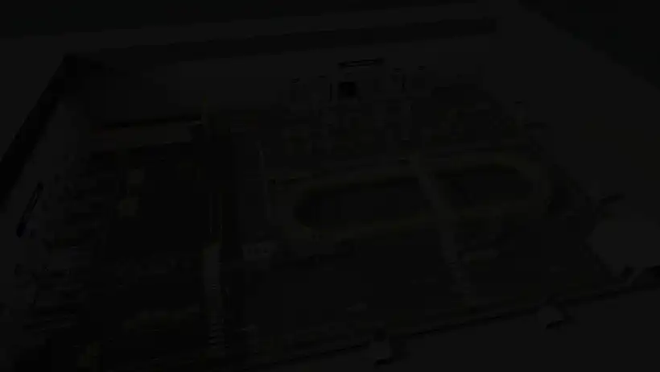

</div>

---

## Why I built it

A parcel hub knows where a parcel was *scanned*. It does not know where it *went*. When one goes missing, someone scrubs hours of CCTV by hand, because the scan system and the cameras don't talk to each other. Meanwhile tracking keeps telling the customer the parcel is on its way.

Spoor joins the two. Every scan becomes a starting point on a camera, every claim is checked against the footage, and anything it cannot see (a room with no camera inside) it says out loud instead of guessing.

> Investigative decision support. Spoor works on parcels, never on people: it never claims anyone's identity, intent or wrongdoing.

---

## A walk through the app

**The landing page.** One parcel's six checkpoints, the scans that agree in green and the two that fail in red.
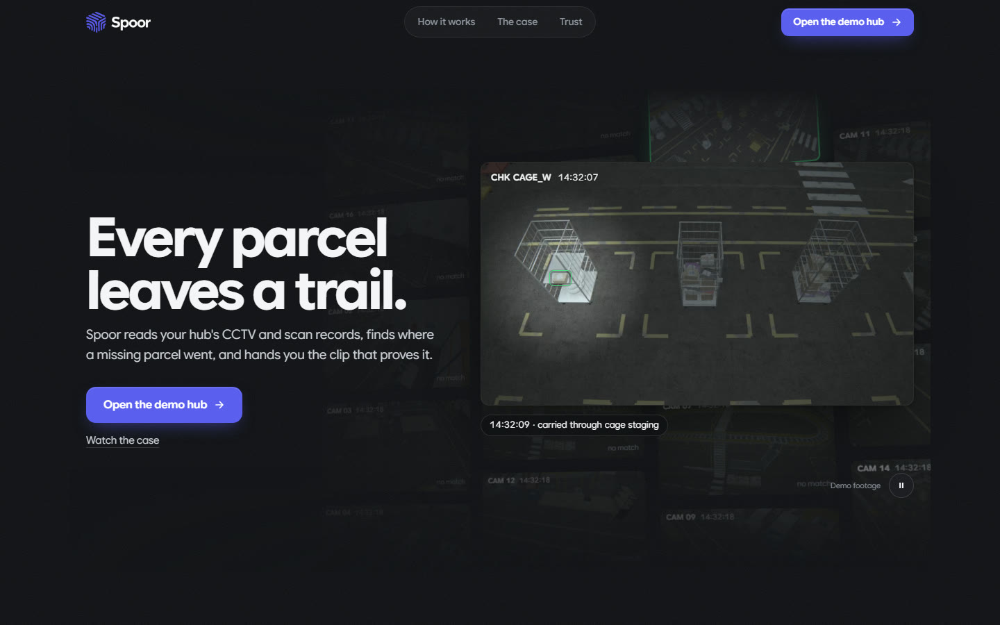
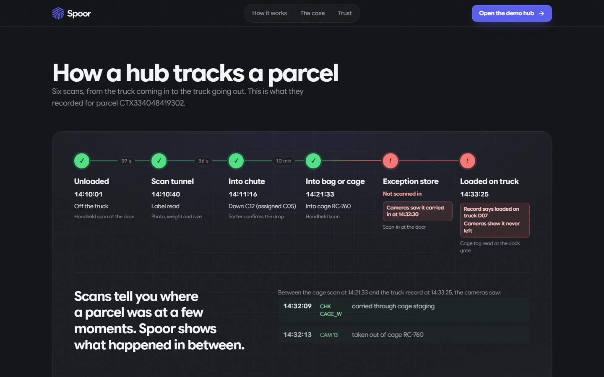

**The hub.** A live alert before anyone complains: a carton taken out of a cage with no scan. Open cases, where each parcel stopped, and the camera frame behind it.
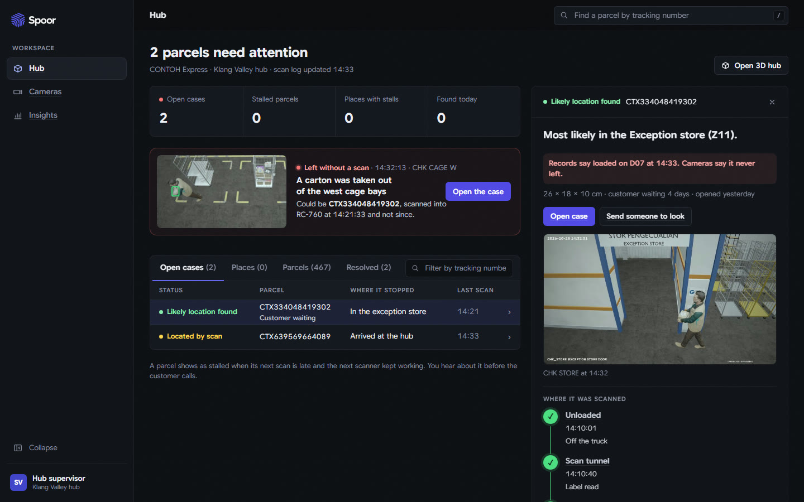

**How the agents worked.** Six questions answered in plain words, every step placed on its agent, and the camera frames they looked at.
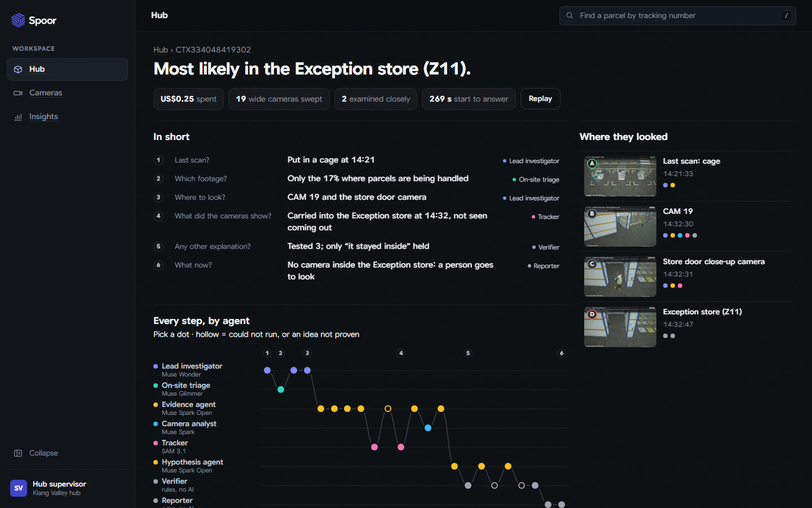

**The answer.** "Most likely in the Exception store", the frame that proves it with SAM 3.1's outline on the parcel, and what Spoor cannot see.
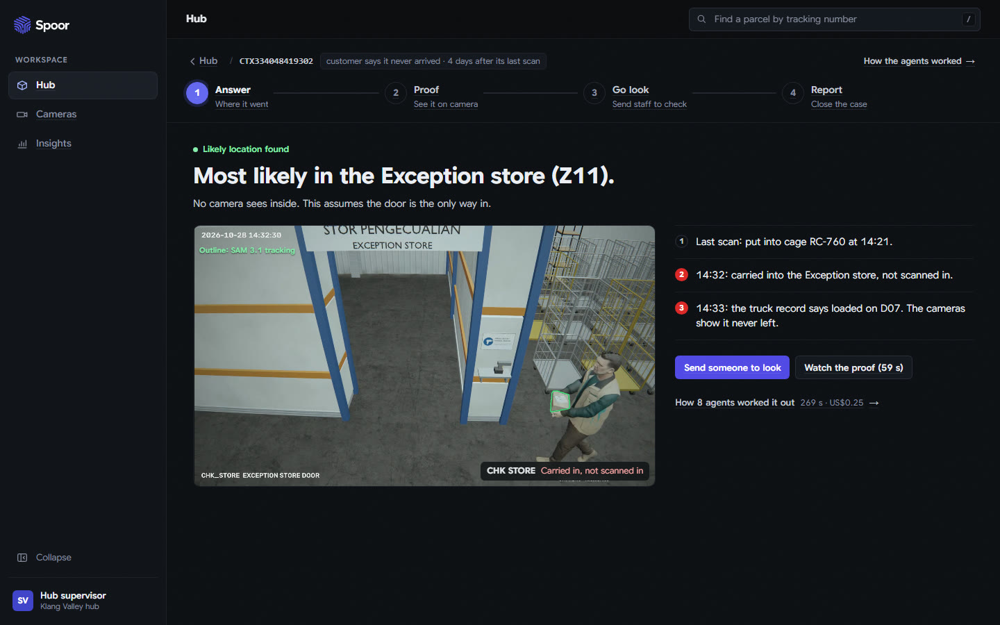

**The proof.** Every step on its own camera, in order, with the route on the floor plan. Red is where the records got it wrong.
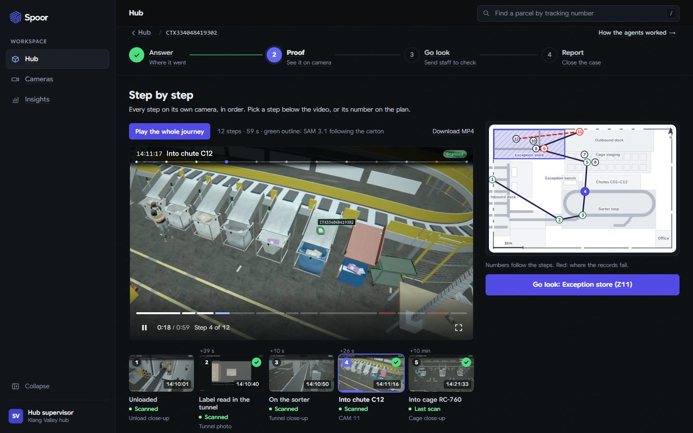

**The route in 3D.** The same route flown through a 3D model of the hub. Dashed where no camera saw the move.
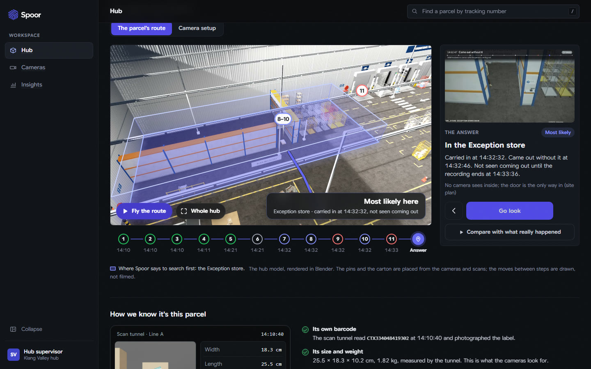

**Go look.** The floor worker's phone: the frame, the parcel's label and size, a walking route, a barcode scan to confirm, and a voice note in Malay or English.
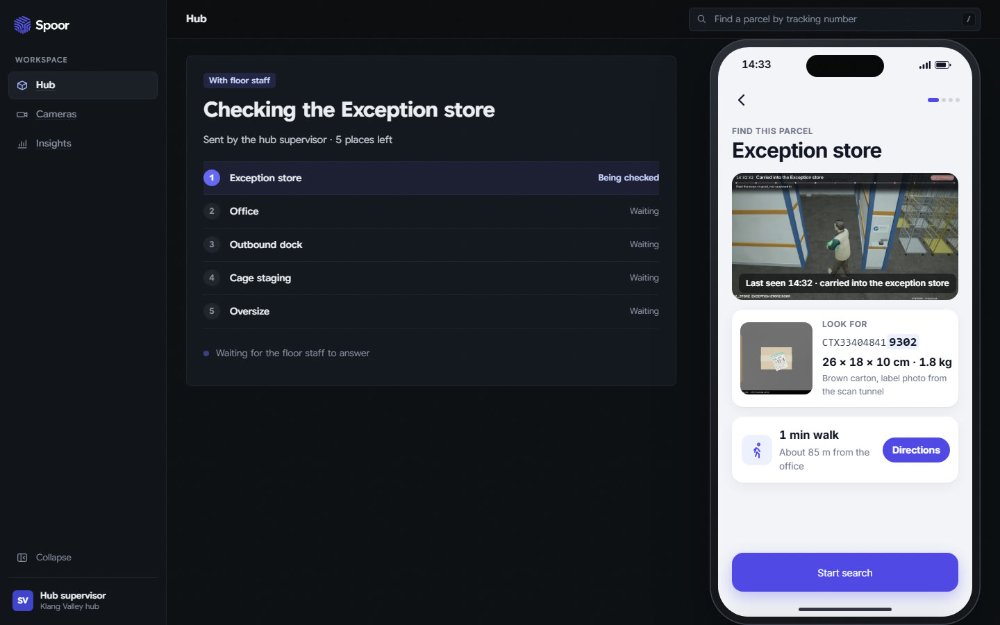
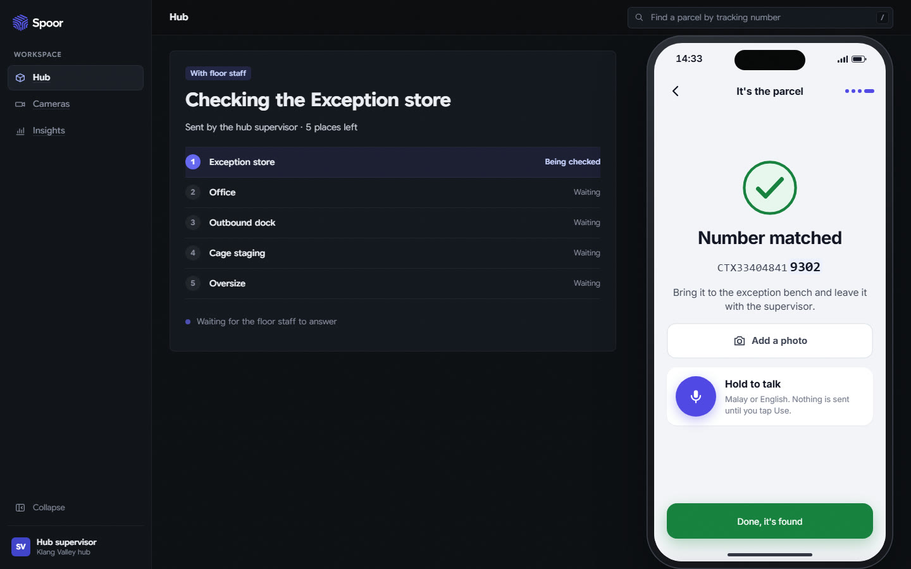

**Report and customer update.** The case file, and a reply drafted from verified facts only, each sentence linked to its proof, in English or Malay. A person approves it.
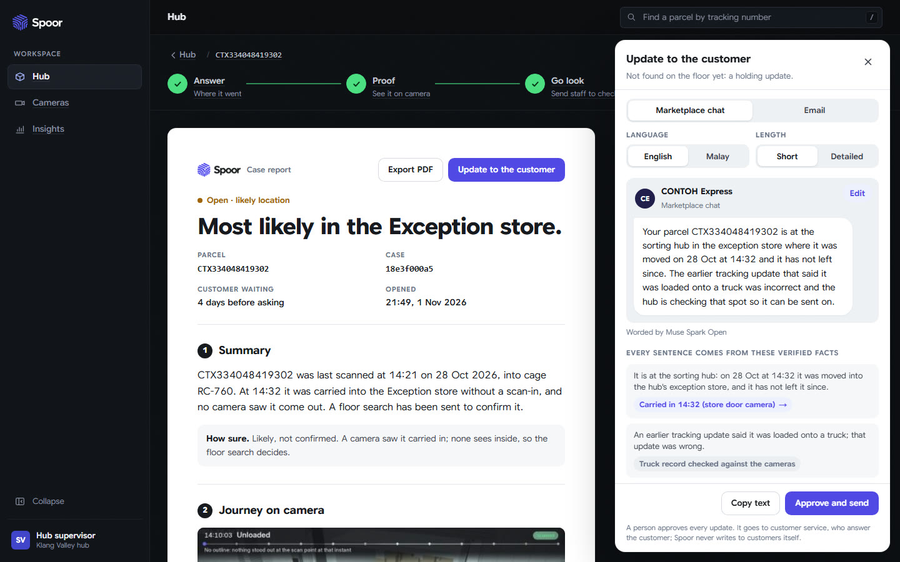
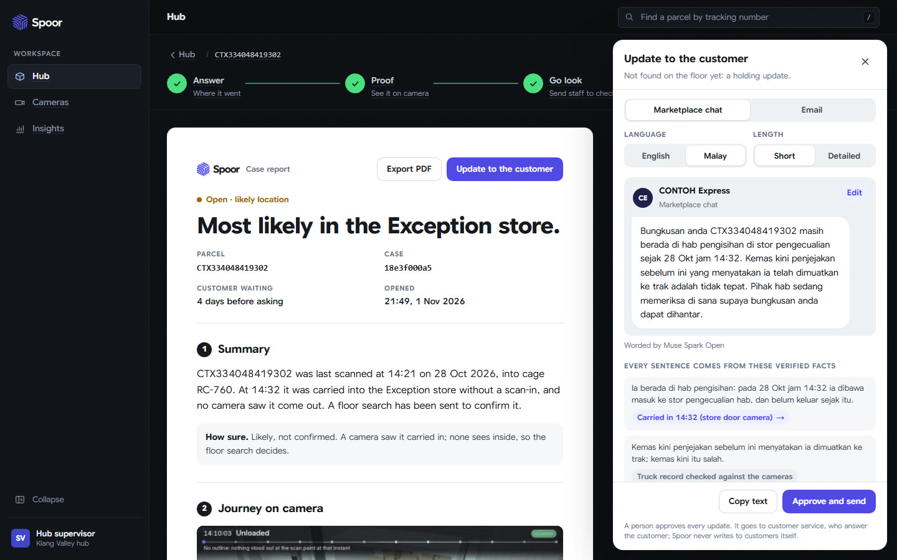

**Hub insights.** Every checkpoint this shift, what to fix first, and whether Spoor's answers held up on the floor.
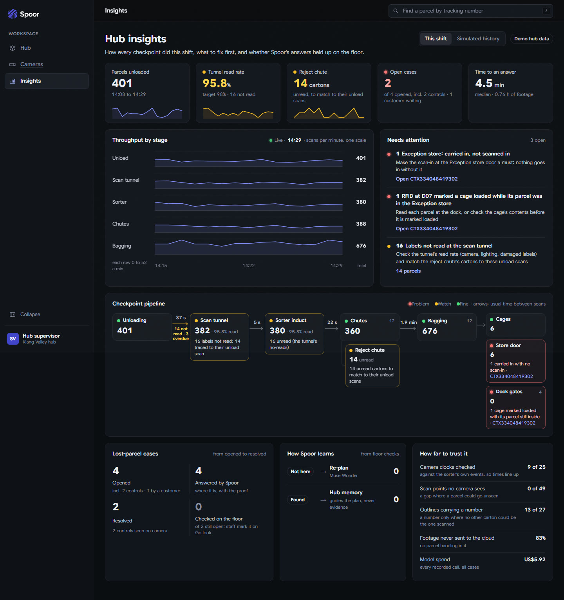

---

## The 3D hub

The whole hub is a simulation built in Blender: 19 wide cameras, 6 checkpoint close-ups, a sorter loop, cages, docks and mocap workers. Real hub CCTV is private, and a simulation is the only place where the true answer is known, so every result can be checked.

<table>
<tr>
<td width="50%">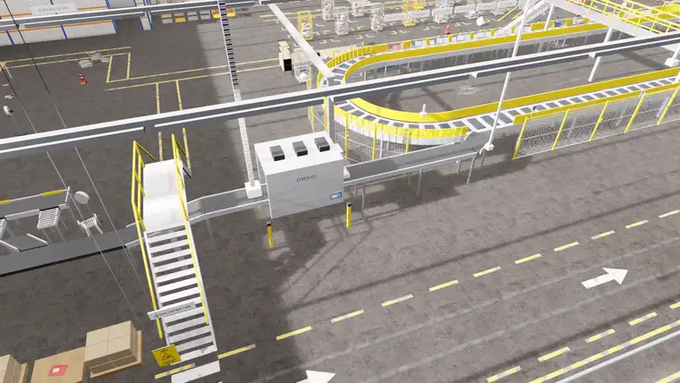</td>
<td width="50%">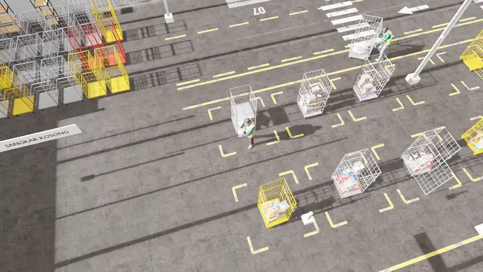</td>
</tr>
<tr>
<td><b>Fly the route.</b> The parcel's route, rebuilt from cameras and scans, flown through the hub.</td>
<td><b>Compare with what really happened.</b> The simulation's ground truth, behind its own button. Spoor never sees it.</td>
</tr>
</table>

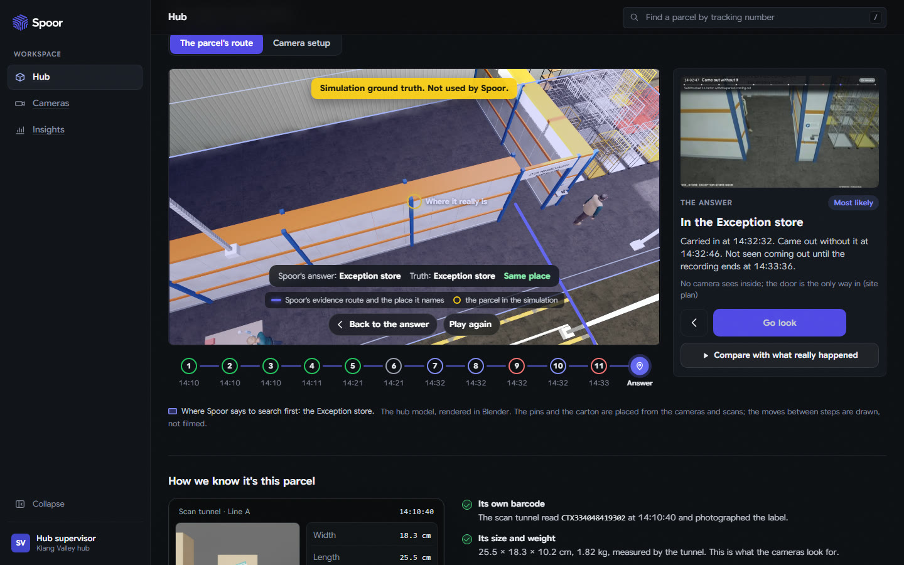

---

## How it works

| Stage | What happens |
|---|---|
| **Triage on site** | Muse Glimmer (open weights, on the hub's own GPU) watches all the footage and flags parcel handling. Only those moments (17 % of it) go on to the cloud models. |
| **Scan to camera** | Each scan's parcel, place and time point to the camera that sees it. SAM 3.1 outlines *that* carton. A number goes on an outline only when no other carton could be the one scanned. |
| **Live alert** | A carton seen leaving a cage area with no scan raises "could be &lt;parcel&gt;" before any customer complains. |
| **Plan** | Muse Wonder, the lead investigator, reads the scan log and plans which cameras and moments to check first. It re-plans when a claim is rejected or the floor search comes back empty. |
| **Investigate** | Muse Spark Open agents on Baseten run the checks with tools (scan history, footage, SAM 3.1 tracking, door crossings, carrier check) and propose explanations. Muse Spark reads short clips as typed observations. |
| **Verify** | A rules-only verifier (no AI) tests every claim against the evidence store. Only verified findings form the answer. |
| **Close the loop** | A floor task with the frame and a walking route; the worker scans the label. The customer update is written from verified facts only, and a person approves it. |

### The agents

| Agent | Model | Job |
|---|---|---|
| Lead investigator | Muse Wonder | reads the scans, plans where to look, re-plans |
| On-site triage | Muse Glimmer (Modal) | keeps only the footage where parcels are handled |
| Evidence agent | Muse Spark Open (Baseten) | pulls scan history and the right camera clips |
| Camera analyst | Muse Spark | checks each clip: seen, or not seen |
| Tracker | SAM 3.1 | follows the parcel and its carrier frame by frame |
| Hypothesis agent | Muse Spark Open (Baseten) | proposes competing explanations as testable claims |
| Verifier | rules, no AI | keeps only the claims the cameras prove |
| Reporter | rules, no AI | creates the floor search task: sends a person to look |

Plus **Muse Voice Transcribe** for the floor worker's voice notes. Muse Image is left out on purpose: an evidence tool must never generate pictures of what happened.

### Architecture

| Layer | Built with |
|---|---|
| Frontend | Next.js 16, React 19, TypeScript, three.js (React Three Fiber), Playwright tests |
| Backend | FastAPI, Pydantic, SQLAlchemy (SQLite, Postgres optional), OpenCV, NumPy, SciPy |
| Meta models | Meta Model API (Muse Wonder, Muse Spark, SAM 3.1, Voice Transcribe); Muse Spark Open on Baseten; Muse Glimmer on Modal |
| Evidence | an append-only evidence store, a scan-to-camera handshake, calibrated camera geometry, a deterministic verifier |
| Simulation | Blender 5.2 (hub, cameras, mocap workers, CCTV renders), a simulated scan log from the same run |
| Rendering | Blender on Modal GPUs and locally, FFmpeg |

---

## Measured

Details and method in [EVALUATION](docs/EVALUATION.md).

| What | Result |
|---|---|
| The lost parcel, keyed runs | "Most likely in the Exception store (Z11)": right in every completed run (6 of 6) |
| Control parcels (look-alike, belt parcel, unload only) | 0 false locations; 2 confirmed on camera at their chute, 1 located by scan |
| Numbers shown on outlines, checked against the render truth | 13 of 13 right; a number is shown only where no other carton could be the one scanned |
| Live alert "left without a scan" | fires once, at the real pick; on no control |
| On-site triage (Muse Glimmer, Modal A100) | 17 % of the footage sent on (83 % less), the key moment kept; US$0.62 |
| Cost of one investigation | Muse Wonder US$0.12 to 0.38, 54k to 129k Spark Open tokens, 2 to 5 minutes |

---

## Tested on real footage

The simulation is not the only test. The same scan-to-camera handshake ran on a real conveyor clip ([Pexels 4156510](https://www.pexels.com/video/packages-moving-on-a-conveyor-belt-4156510/), Pexels licence), with a hand-made scan log, a panning camera and the workers' faces blurred before anything reached SAM.

| | Result |
|---|---|
| Scans whose outline found the right item and stayed on it | **9 of 11** |
| Checkpoints (the scan frame and every second after) on the right item | **51 of 63 (81 %)** |
| Where it failed | two touching yellow sacks (look-alikes) got one outline over both |

**Right:** each scan's outline (green) lands on the item at the scan spot and follows it along the belt, including half-hidden ones.
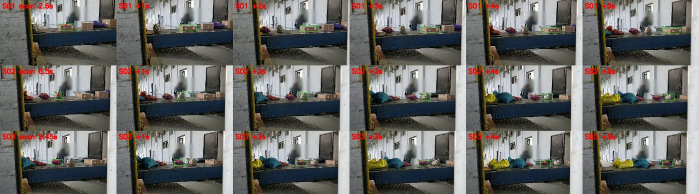

**The miss:** two yellow sacks touching. One outline covers both until they part.
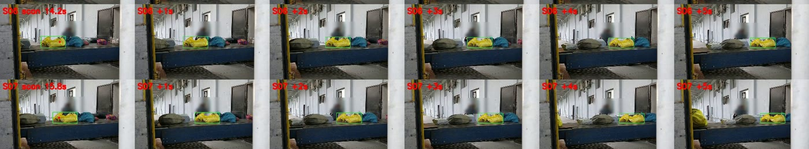

One clip only, judged by eye (no hand-drawn boxes, so no IoU). Scripts in [assets/realtest](assets/realtest), write-up in [EVALUATION](docs/EVALUATION.md#real-footage-the-handshake-on-a-real-conveyor-clip-2026-11-03).

---

## Real vs simulated

| Item | What it is |
|---|---|
| CCTV footage | Synthetic: a Blender render of a fictional hub (CONTOH Express), CCTV look and on-screen clocks, every clip marked SYNTHETIC |
| Scan log | Simulated (`scan_simulated`), from the same simulation as the render |
| SAM 3.1 outlines, Muse Wonder plans, Spark Open agents, Glimmer flags | Real model calls on that footage |
| Floor positions | Estimated from calibrated camera geometry (held-out error 1 to 2 cm) |
| Camera clocks | Fitted from sorter events by Spoor, never read from the render |
| Ground truth | Read only by the evaluator after a run, and shown only behind "Compare with what really happened"; never used by the app or in a prompt |

---

## Getting started

**Prerequisites:** Python 3.13 · [uv](https://docs.astral.sh/uv/) · Node.js 20 · FFmpeg on PATH · a Meta Model API key and a Baseten key for live runs.

```bash
git clone https://github.com/RextonRZ/Spoor.git
cd Spoor

# backend: tests need no keys
cd backend && uv sync && uv run pytest

# frontend
cd ../frontend && npm install
npm run backend:keys     # starts the API with MODEL_API_KEY (Meta) and BASETEN_* from backend/.env
npm run dev              # http://localhost:3000
```

**Key environment variables** (`backend/.env`, never committed; see `backend/.env.example`):

```bash
MODEL_API_KEY=...        # Meta Model API: Muse Wonder, Muse Spark, SAM 3.1, Voice Transcribe
BASETEN_API_KEY=...      # Muse Spark Open (evidence and hypothesis agents)
BASETEN_MODEL_ID=...
AGENT_BACKEND=meta       # or baseten
```

The demo store and the rendered footage are not in the repository (size). [DEMO_SCRIPT](docs/DEMO_SCRIPT.md) has the path through the app, [DEPLOYMENT](docs/DEPLOYMENT.md) the setup.

---

## Docs

[EVALUATION](docs/EVALUATION.md) · [LIMITATIONS](docs/LIMITATIONS.md) · [DEMO_SCRIPT](docs/DEMO_SCRIPT.md) · [META_MODEL_USAGE](docs/META_MODEL_USAGE.md) · [DECISIONS](docs/DECISIONS.md) · [CALIBRATION](docs/CALIBRATION.md) · [EVIDENCE_SCHEMA](docs/EVIDENCE_SCHEMA.md) · [PRIVACY](docs/PRIVACY.md) · [DATA_RIGHTS](docs/DATA_RIGHTS.md) · [DEPLOYMENT](docs/DEPLOYMENT.md)
